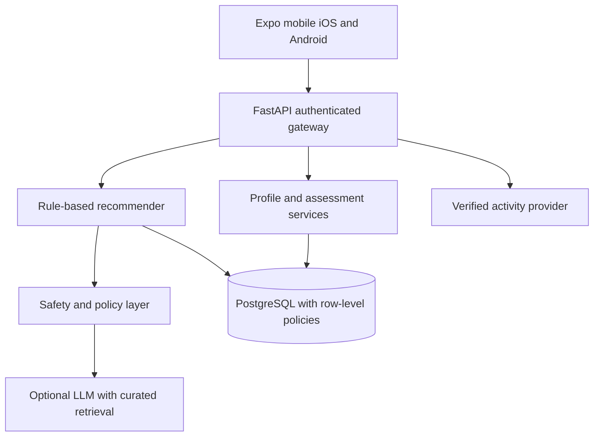

# Architecture

Current implementation: mobile local-state demonstration and separate stateless API with health and constrained plan endpoints. All other boxes are proposed. Use server-side JWT verification, ownership checks and rate limits before integration. LLM keys belong only to backend. Treat retrieved documents as untrusted data, validate structured output, and provide safe fallback when the provider fails. Start with deterministic recommendations; do not train on user data by default.

Proposed schema: profiles, consents, preferences, assessments, checkins, interventions, action_plans, actions, events, research_outcomes. Separate research identifiers from account records. Define retention and test cross-account access before deployment. Use migrations and synthetic fixtures only in this public repository.

Decision: Expo SDK 56, React Native 0.85, TypeScript and Python FastAPI. Simple tab state for prototype; introduce Expo Router when routes require deep linking. No native build has been validated yet.
